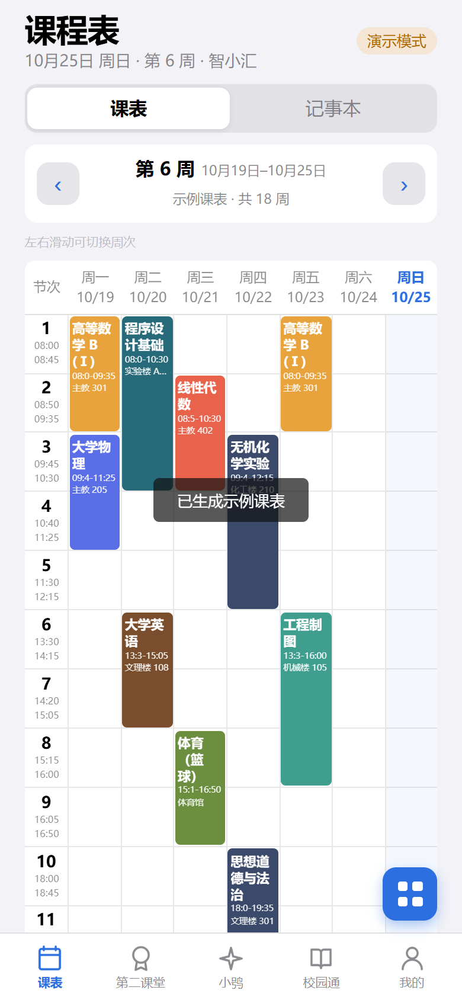
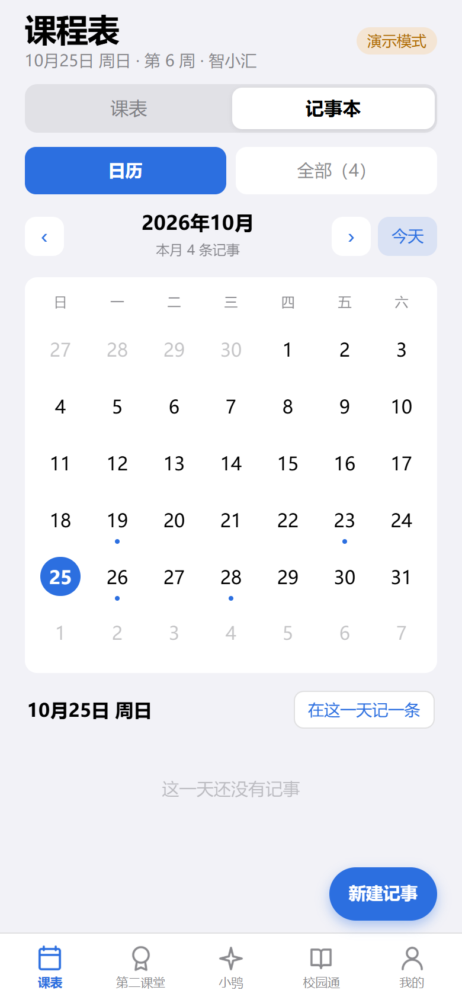
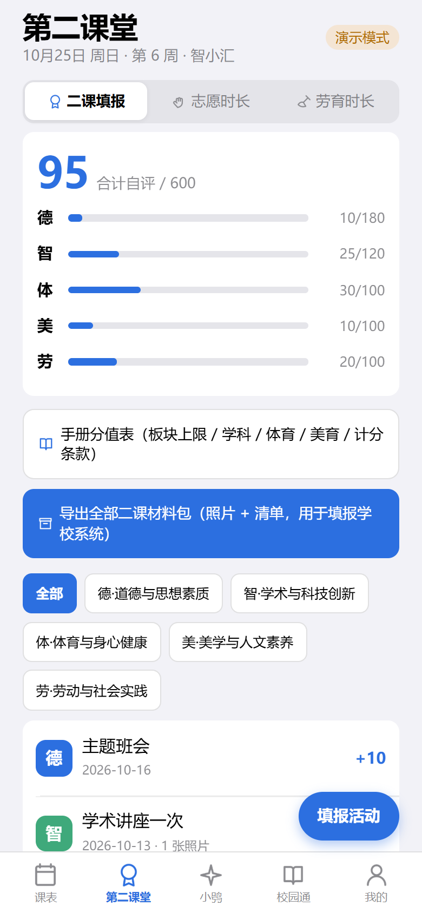
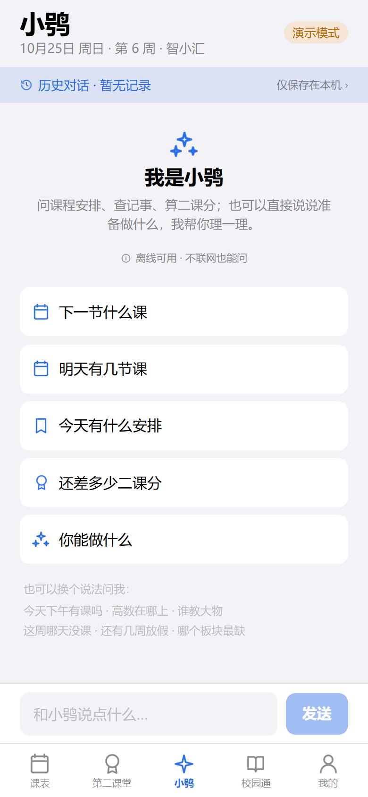
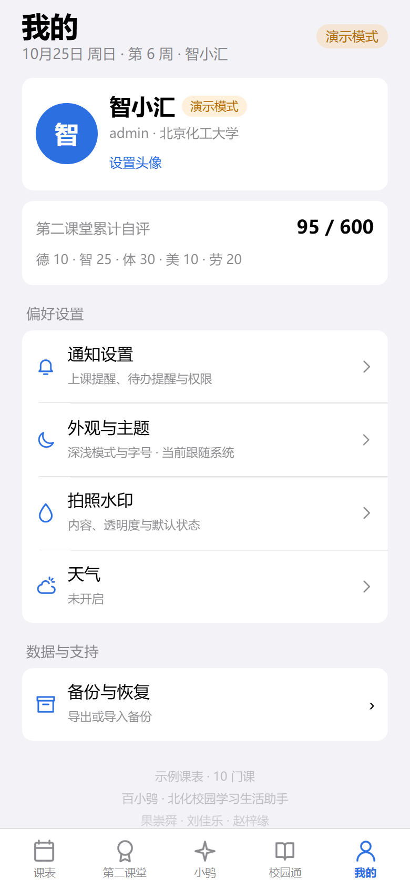
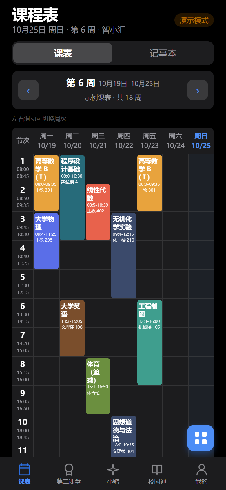
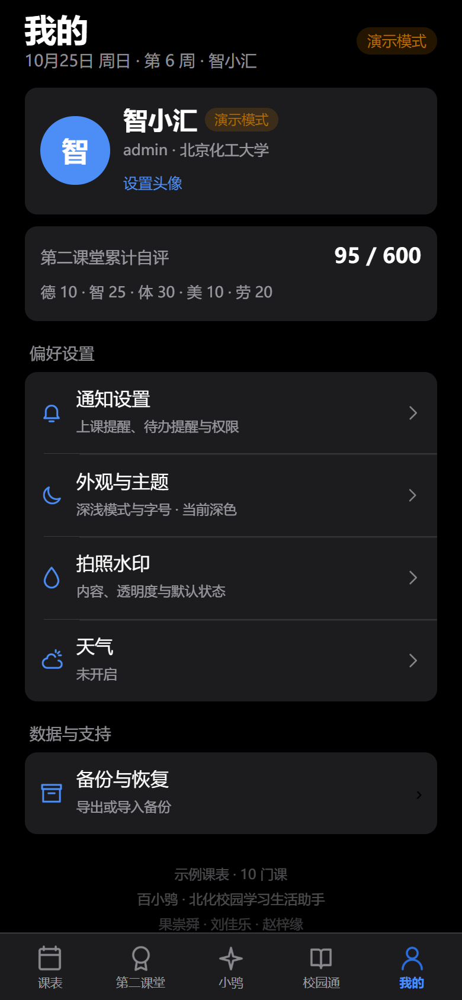

# 百小鸮 · BaiXiaoXiao

> 北京化工大学校园学习生活助手 — 微信小程序版。
> 课表、记事、第二课堂、校园服务，数据全部留在本机。

<p align="center">
  
  
  
  
  
</p>

<p align="center">
  
  
</p>

<p align="center"><sub>上排浅色 · 下排深色（跟随系统）</sub></p>

---

## 这是什么

一个用 **uni-app 3 + Vue 3 + TypeScript** 写的微信小程序，把原本的 Android（Capacitor）版本搬到了微信里。

面向的场景很具体：大学生每天要看的就那几件事——今天上什么课、还有多少二课分没攒够、记事本里欠了哪些作业。这些信息原本散在教务系统、学校门户和纸质记录里，这个应用把它们收进一个能离线打开的壳子里。

**没有后端。** 课表、记事、二课记录全部存在手机本地（`uni.setStorageSync`），不上传任何服务器。除了「从教务系统导入课表」那一次请求，全程不需要联网。

## 功能

| 模块 | 能做什么 |
|---|---|
| **课程表** | 表格布局（节次列 + 7 日列）；周次栏 `‹ 第 N 周 10月19日–10月25日 ›`，支持左右滑动切周、一键回本周；点课程块看详情、编辑、删除 |
| **多课表** | 新建 / 切换 / 改名 / 改总周数 / 改第一周周一 / 删除；手动添加课程支持校区、学分、考核方式、周次多选、18 色配色 |
| **从教务导入** | 直连正方 `jwglxt`：取 csrftoken 与 RSA 公钥 → 本地加密密码 → 登录 → 拉取 `kbList` 解析入库；内置北化地址，其它学校可手动填 |
| **记事本** | 42 格月历，今天高亮、有记事的日期打点；按天查看、新建、勾选完成 |
| **第二课堂** | 五板块自评（德 180 / 智 120 / 体美劳各 100，合计 600）；志愿时长、劳育时长记录 |
| **小鸮（助手）** | 完全离线的问答：下一节课、某门课在哪上、哪天没课、还差多少二课分、校园入口在哪…… 35+ 意图，答案全部从本机数据算出来 |
| **校园通** | 教务、成绩、图书馆、校园网、体测等 10 个入口，点一下复制链接 |
| **深色模式** | 跟随系统，也可手动锁定浅色/深色；页面、弹层、表单、月历同步换色 |

## 技术栈

| 层 | 选型 |
|---|---|
| 框架 | uni-app 3（Vue 3 组合式 API + TypeScript） |
| 构建 | Vite 5 |
| 目标平台 | 微信小程序（同时可构建 H5 用于预览与自动化测试） |
| 状态 | `reactive` 单例 + Storage 持久化，无 Vuex/Pinia |
| 样式 | 原生 CSS 变量驱动主题，rpx 布局 |
| 依赖 | 运行时零第三方 UI 库，图标由脚本从 SVG 路径光栅化生成 |

## 快速开始

```bash
cd baixiaoxiao-mp
npm install
```

开发（产物输出到 `dist/dev/mp-weixin`）：

```bash
npm run dev:mp-weixin
```

用微信开发者工具导入 **`dist/dev/mp-weixin`**，AppID 可先选「测试号」。

构建正式版（上传用）：

```bash
npm run build:mp-weixin
```

⚠️ 导入开发者工具时目录要选 `dist/build/mp-weixin`，**不是项目根目录**，否则会报「app.json 未找到」——这是 uni-app 最高频的坑。

## 项目结构

```
.
├── baixiaoxiao-mp/          小程序工程
│   ├── src/
│   │   ├── pages/
│   │   │   ├── main/        单页壳：页头 + 5 个视图 + 自绘 tabBar
│   │   │   └── import/      教务导入：选校 → 登录 → 预览入库
│   │   ├── views/           五个页面视图（课表/记事/二课/小鸮/校园通/我的）
│   │   ├── stores/app.ts    状态与全部业务逻辑（多课表、周次、冲突检测）
│   │   ├── services/
│   │   │   ├── jw/          正方教务协议（地址解析、登录、课表拉取）
│   │   │   ├── xiao/        小鸮离线对话引擎
│   │   │   └── theme.ts     深色模式
│   │   ├── adapters/        平台适配层（存储、请求、加密、通知）
│   │   ├── shared/          纯逻辑（RSA、课表解析、节次时间、配色）
│   │   └── components/      通用组件
│   └── scripts/             自检与资源生成脚本
├── docs/shots/              界面截图
├── 百小鸮-小程序迁移指南.html   迁移决策与踩坑记录（直接浏览器打开）
├── 百小鸮-小程序发布上线操作手册.docx   上传与审核的完整流程
└── LICENSE
```

**为什么是「单页 + 自绘 tabBar」**：原生 tabBar 的颜色只能靠 `theme.json` 配置，深色模式要再维护一份且容易漏。自己画才能让 tabBar 跟着主题走，顺带切 tab 不重建页面、状态天然共享。

## 两个值得说的设计取舍

**小鸮为什么不用大模型。** 这一页看起来是聊天，但没接任何 API。三条硬约束：① 使用环境不保证联网；② 小程序前端放不住 API Key，抓包就能拿走；③ 课表、记事、二课分是个人数据，不该为了回答「明天几节课」把整份课表传到别人服务器上。所以它是一个「规则 + 本机数据」的问答引擎，代价是覆盖面有限，好处是**不会编**——答不上来就直说没学会。

**多课表的存储迁移。** 早期版本只有一张隐式课表，课程没有归属。支持多课表后必须补 `timetableId`，存储键从 `state/v1` 升到 `state/v2`，首次启动自动把旧数据挂到「我的课表」下。小程序没有「重装」这个动作，Storage 会一直留着，写错一次迁移逻辑就是永久性的。

## 测试

三个自检脚本都跑在 H5 构建产物上，不进小程序包：

```bash
cd baixiaoxiao-mp
npm run build:h5

node scripts/e2e.mjs         # 交互冒烟 31 项：五个 tab、加课→刷新仍在、深色模式
node scripts/unit-jw.mjs     # 教务协议层 33 项：地址解析、登录页解析、RSA 往返
node scripts/unit-xiao.mjs   # 小鸮对话引擎 60 项：109 条问法覆盖率
```

全部输出 `合计 N 项，失败 0 项` 才算干净。`e2e.mjs` 需要本机装有 Edge 或 Chrome。

## 已知限制

- **需要配置服务器域名**：在微信公众平台把 `https://jwglxt.buct.edu.cn` 加进 request 合法域名，否则真机导入课表会失败（开发者工具可以勾「不校验合法域名」绕过，真机不行）。
- **校外访问受学校网络限制**：多数高校教务只对校内网开放，校外需要先连学校 VPN。
- **上架需 ICP 备案**：2023 年 9 月起强制，未完成备案不能提交审核。详见发布手册。
- **仅适配正方教务系统**：其它教务系统（URP、强智等）尚未支持。

## License

[MIT](LICENSE)
