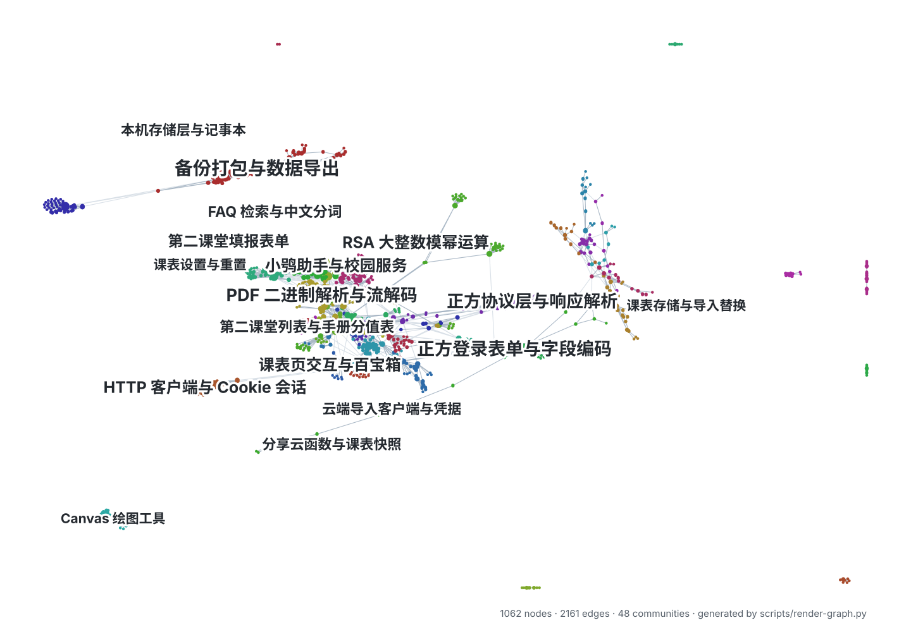

# 百小鸮 · 北化校园助手（微信小程序）

课表、记事、第二课堂、校园入口，一个**数据默认只存在手机本地**的校园小程序。原生微信小程序实现，零第三方运行时依赖，不需要自建服务器；课表可以用 PDF 在本机解析，也可以选「云端导入」由云函数代登教务（需开通云开发）。

<p align="center">
  
</p>

> 本仓库早期是一版 uni-app 实现，现已整体替换为根目录下的原生小程序版本；旧代码仍可在提交历史里找到。

## 功能

| 模块 | 能做什么 |
|---|---|
| **课表** | 按周查看，左右滑动或点箭头切周，自动定位本周、高亮今天与当前节次，显示下一节课与倒计时；右下角**百宝箱**可自由拖动，装下导入课表、教务直连、添加课程、课表设置、记一件事、回到本周与分享课表 |
| **课表导入** | ① 云函数代登教务系统抓取（推荐）；② 选课表 PDF 本机解析。导入前弹窗预览，可替换或追加 |
| **记事** | 课表页顶部切到「记事本」：42 格月历，有记事的日期打点，点某天看当天待办；支持日期归档、完成状态、二次确认删除 |
| **小鸮** | 本机 Agent：回答本周几节课、某天课表、下一节在哪、某门课第几周、今天还剩几节；能直接说「记一下 周五交实验报告」 |
| **校园服务** | 九个常用入口（教务、图书馆、门户、校园网…），配好网址的点击复制链接 |
| **第二课堂** | 五板块（德智体美劳，合计 600 分）自评账本：按板块封顶统计、志愿/劳育时长两条独立口径、内置手册分值表（板块上限/学科/体育/美育/计分条款），照片可打时间地点水印 |
| **我的** | 头像昵称、课表设置、数据统计；**备份到微信**（课表 + 二课 + 照片打成一个 zip）与**从备份恢复**（换手机用） |

## 快速开始

```bash
# 单元测试（Node 18+，不需要 npm install）
npm test
```

在微信开发者工具里：

1. 选择「导入项目」，目录选**本仓库根目录**（就是能看到 `app.json` 的那一层）
2. 打开后进「详情 → 基本信息 → AppID」，改成你自己的小程序 AppID
3. 要用「云端导入」，还需开通云开发并把环境 ID 填到 `app.js` 顶部的 `CLOUD_ENV`（留空则使用该 AppID 下的默认环境）
4. 点击「编译」

> **AppID 不要写进 `project.config.json`。**
> 仓库里那一行固定是占位符 `wxYOUR_APPID_HERE`，真实的 AppID 请让它落在
> `project.private.config.json`（已在 `.gitignore` 里）。开发者工具改 AppID 时也会
> 自动写进这个私有文件——官方文档的原话是「如在 `project.private.config.json` 有
> `appid` 字段，那么在详情-基本信息中修改了 appid，会写到 `project.private.config.json`
> 中，不会覆盖掉 `project.config.json` 的 `appid` 字段的内容」。
> 这样两个人的本地配置互不影响，PR 合并也不会再在 appid 那行打架。

项目使用微信原生小程序语法，**没有任何第三方运行时依赖**，也不需要 `npm install`。

## 第二课堂

按《北京化工大学本科生学生手册·学生事务管理制度》的口径做的一个本地账本：

- **三个页签**：二课填报 / 志愿时长 / 劳育时长。志愿与劳育是**独立口径**，不进 600 分的自评
- **五板块**：德 180、智 120、体 100、美 100、劳 100，合计 600。每个板块按满分封顶（手册口径：高于满分按满分计），同时保留原始累计供核对
- **手册分值表**：板块上限、学科竞赛、体育竞赛、美育比赛四张分值表 + 29 条计分条款，条款支持关键词搜索
- **填报活动**：五段色带选板块 → 顶部实时回显「本档已用 X/上限 Y，还能加 Z 分」→ 写名称与描述 → 定日期与评定类型 → **按手册条款打分**（29 条条款可搜索，选中即自动填分并留下依据）→ 自由填报兜底 → 一张证明照片
- **照片水印**：位置用 `wx.chooseLocation` 打开微信地图选点，直接拿到地点名与地址（不需要地图 Key、也不用自己做逆地理编码），保存时把「时间 + 地点」画到照片底部（2d canvas）。定位开关关掉时会把已存的地点一并清掉
- **草稿续填**：填到一半被电话打断也不白填，草稿落在本机，下次进表单自动接上
- **上限封顶**：分数按手册口径封顶（德 144/36、智 96/24、体/美/劳 80/20），换板块或换评定类型时会立刻收进新上限并提示
- **导出材料包**：打成一个 zip（`二课记录.csv` + `二课记录.json` + `说明.txt` + `照片/序号-活动名.jpg`），用 `wx.shareFileMessage` 发给「文件传输助手」，就长期留在微信里；CSV 一条记录对应一张照片，不用自己一张张对
- **清单长图**：另外可把「合计自评 + 五板块 + 明细」画成一张 750 宽的图存进相册，适合打印或发群里
- **为什么是 zip 不是文件夹**：小程序不能往手机文件系统写文件，能交到用户手里的出口只有「微信会话」和「相册」。zip 用 store 模式现写（`utils/zip.js`，小程序没有 zlib），照片本身已是压缩格式，不再压缩
- **照片格式**：文件名后缀以 `wx.getImageInfo` 探测的真实类型为准（jpg/png/gif/webp/heic…），不依赖临时路径的命名

## 分享课表

百宝箱里有「分享我的课表」，生成一张竖版课表图；如果云开发部署了 `share` 云函数，图底部还会带一个**小程序码**：

- 对方扫码 → 直接打开小程序，看到的是**你的课表**（只读，顶部有「存到我的课表」按钮）
- 没部署云函数时自动退化成纯图片分享，不影响使用

云函数 `cloudfunctions/share` 三个动作：

| 动作 | 做什么 |
|---|---|
| `save` | 把课表快照（课名/星期/节次/周次/教室/教师/校区）存到云存储，返回 6 位分享码 |
| `get` | 按分享码取回快照，扫码打开时调用 |
| `qrcode` | `wxacode.getUnlimited` 生成小程序码，存云存储并返回 fileID |

**部署**：开发者工具里右键 `cloudfunctions/share` → 「上传并部署：云端安装依赖」。`config.json` 已声明 `wxacode.getUnlimited` 权限。

**测试注意**：小程序没发布过正式版时，小程序码会退回 `envVersion: 'trial'`（体验版），扫码的人必须是体验成员。

## 备份与恢复

「我的 → 备份到微信」打一个 zip，发给「文件传输助手」就等于存在微信里了：

```
百小鸮备份-20261108/
├── 课表.csv / 课表.json      课程 + 学期设置（恢复只认 json）
├── 二课记录.csv / .json      一条记录对应一张照片
├── 二课时长.json             志愿 / 劳育（独立口径）
├── 照片/01-活动名.png        周序号与 CSV 的「序号」一致
└── 说明.txt
```

「我的 → 从备份恢复」用 `wx.chooseMessageFile` 从聊天记录里挑回这个 zip，解出来的课表、二课、时长和照片会覆盖本机数据。整套往返（打包 → 解包 → 解析）都有测试。

## 课表导入

课表页右下角的**百宝箱**里有「导入课表」与「PDF 导入」两个并列入口。

「导入课表」走**云端导入**：小程序把学号密码交给自己的云函数，由云函数登录正方 `jwglxt` 取回课表。真机直连过不了微信网络层（请求头被改写、POST 丢 Cookie、多节点会话漂移），云函数绕开了这三层。页面顶部可随时切到 PDF 导入，云端失败时也固定给出「改用 PDF 导入」的出口。

### ① 云函数导入（推荐）

三件事都由你自己配：

1. 开通云开发（个人主体可用，小程序未发布上线前免费），拿到环境 ID
2. 填到 `app.js` 的 `CLOUD_ENV`；留空则使用该 AppID 下的默认环境
3. 右键 `cloudfunctions/jwimport` →「上传并部署：云端安装依赖」，再到控制台把**超时改成 20 秒**（默认 3 秒不够，登录链路要 5–15 秒）

云函数零第三方依赖。`lib/` 下的 `zfClient.js`、`crypto.js` 与小程序端 `utils/jw/` 是同一份协议层，只把最底下的网络层换成 `node:https`（`net.js`），并用一条 keep-alive 连接走完四步——正方私钥存在服务端会话里，请求漂到另一台节点就解不开密文。

密码只在云函数内存里用一次，不写数据库、不写日志，调用结束随实例回收。

### ② PDF 导入

百宝箱 →「PDF 导入」→ 选文件 → 确认预览 → 选替换或追加。

导出方式：浏览器进教务「信息查询 → 学生课表查询」，选好学年学期点「输出 PDF」，把文件发到微信（文件传输助手即可），再回小程序选择。

**不需要登录、不需要学号密码、不联网、不上传。** 解析链路全部在小程序内（`utils/pdf/`）：

1. `inflate.js` 自研 DEFLATE 解压 `FlateDecode` 内容流（与 Node zlib 逐字节比对过）
2. `extract.js` 从 `Tm` / `Td` 取坐标、`Tj` 取文字，按 UCS-2 还原中文
3. `parser.js` 用「星期一 ~ 星期日」表头锚定七列，按坐标归星期、按行拼接课程块
4. `courses.js` 映射成课表页使用的对象，复用同一套 `parseWeeks` 与配色

支持学校课表页「输出 PDF」的两种模板，自动识别：

| 模板 | 版式 | 识别依据 |
|---|---|---|
| **表格式** | 星期在表头，课程块里带 `(1-2节)` | 课程块内含节次标记 |
| **列表式** | 星期 / 节次 / 课名 / 详情四列，按天分段 | 左侧有星期标签 + 独立节次列 |

两者都要求带文字层、`UniGB-UCS2-H`、`FlateDecode`。截图、扫描件、加密 PDF、模板变化都会给出具体原因，不会写入半成品。跨页被切开的课程名会自动接回去。

### ③ 本机直连（已从界面收起）

`utils/jw/session.js` 里仍保留走 `wx.request` 的直连实现，但界面上不再提供入口：它依赖 request 合法域名白名单，真机上 POST 又容易丢 Cookie，正方多节点还会让会话漂移，成功率不稳。留着的价值是本地用 `scripts/probe-jw.js` 排查学校接口变化。

## 小鸮：一个跑在本机的迷你 Agent

不接大模型，也没有后端。它用一个很小的 Agent 循环把「自然语言 → 动作」跑通：

```text
输入 → 抽槽 → 意图打分 → 选工具 → 缺槽反问 → 执行 → 记忆
```

| 环节 | 实现 |
|---|---|
| 抽槽 | 时间（今天/明天/周X/下周X/下下周/第十周）、时段（上午/下午/晚上/第 3-4 节）、课程名、记事内容 |
| 课程名识别 | 全名精确 → 跳字简称（子序列，`高数`→高等数学）→ 错别字（编辑距离 ≤1）；两字简称标记为弱匹配，避免「数据还在吗」误命中《数据结构》 |
| 意图打分 | 每个工具声明「触发词 + 权重」，命中累加取最高；同分按优先级让更具体的胜出。顺序无关、权重可调 |
| 工具表 | 14 个：周课表、日课表（可加时段）、下一节、今日剩余、空档日、某门课、记事、待办、导入指引、隐私、学期、校园服务、帮助、打招呼 |
| 缺槽反问 | 没说课名就问「哪门课？」，没说内容就问「要记什么？」；两门像的课会让你选 |
| 记忆 | 记住上一轮工具与槽位，`那周三呢`「明天呢」「它呢」能顺着接上；只存在页面内存，不落盘 |
| 动作 | `记一下 周五交实验报告` 返回 `action.createNote`，由页面写存储（utils 层不碰 wx API） |
| 兜底 | BM25 检索 9 条 FAQ（中文按 bigram 切词 + 同义词归一），归一化分数低于 0.2 才承认答不上来 |

调参时可以直接看打分，不用猜：

```bash
node -e "console.log(require('./utils/agent/index.js').explain('周三下午有什么课', {}))"
# [ { name: 'day_schedule', score: 7 } ]
```

**为什么不用大模型**：客户端放不住 API Key（抓包就能拿走）；要为它配域名白名单；而课表、记事是个人数据，不该为了回答「明天几节课」把整份课表传到别人服务器。代价是覆盖面有限，好处是**不会编**——答不上来就直说。

## 数据与隐私

- 课表、记事、第二课堂记录与时长、头像昵称、对话历史、未保存的草稿、分享码缓存，全部存在 `wx.setStorageSync`，卸载或清理小程序数据即消失
- 共 10 个存储键：7 个业务数据（课表 / 作息 / 记事 / 对话 / 二课 / 二课时长 / 资料）+ 3 个临时态（未保存的草稿 / 分享码缓存 / 百宝箱浮球位置），彼此独立，删一个不影响别的
- 未导入时课表为空，仓库不带示例数据；旧版本写入的 demo 课表会在读取时自动清理
- PDF 只在本机内存解析，文件不上传
- 云端导入时学号与密码会经过**你自己的云函数**（腾讯云托管）：只在内存里用一次，不写数据库、不写日志，导入结束即弃
- 头像使用微信官方「头像昵称填写能力」，选完转存到小程序用户目录，不经过服务器
- 仓库不含真实课表 PDF、个人姓名学号与本地私有配置：`project.private.config.json`、`tests/fixtures/`、`*.pdf` 都在 `.gitignore` 里，AppID 与环境 ID 用占位符；缺样本时相关用例自动跳过

## 工程实现

### 目录

```
.
├── app.js / app.json / app.wxss   小程序入口、全局配置与样式
├── pages/           课表（含记事本视图）、第二课堂、小鸮、校园、我的
│                    + 课程/记事/二课编辑、设置、两个导入页
├── cloudfunctions/  jwimport：代登正方并取回课表（node:https，零依赖）
│                    share：存课表快照、出小程序码
├── utils/
│   ├── jw/          正方协议层（RSA、登录页解析、Cookie 罐）与云端调用封装
│   ├── pdf/         自研 DEFLATE、文字坐标提取、课程块还原
│   ├── agent/       小鸮的 NLU、工具表、BM25 兜底
│   ├── secondclass.js  第二课堂的板块、条款、分值表与统计口径
│   ├── zip.js       手写 zip 写入/解析（小程序没有 zlib）
│   ├── backup.js    备份包与材料包的内容组织
│   ├── materials.js 清单长图与 CSV/JSON 的排版计算
│   ├── shareCard.js 课表分享图与海报排版
│   └── 其它         日期/周次、配色、存储、二次确认、个人资料
├── data/            默认作息、校园服务清单（示例课表仅供测试，不参与初始化）
├── assets/          品牌图、校园服务图标、tabBar 图标、吉祥物
├── scripts/         图标生成、吉祥物抠图与水印、PNG 重压缩、
│                    教务链路探测、图谱构建（都不参与打包）
└── tests/           Node 单元与结构测试
```

### 架构地图

用 [graphify](https://github.com/safishamsi/graphify) 对全仓建过知识图谱：**1062 节点 / 2161 边 / 48 个社区，无循环依赖**。产物在 `graphify-out/`（已 gitignore，不进包），打开 `graph.html` 可以拖拽查看、按社区着色。

<p align="center">
  <picture>
    <source media="(prefers-color-scheme: dark)" srcset="docs/graph-dark.svg">
    
  </picture>
</p>

> 一个点是一个代码符号，颜色是模块社区，连线是依赖关系；大点是被引用最多的核心函数。图由 `scripts/render-graph.py` 从 `graph.json` 现算布局生成（亮 / 暗两套，跟 GitHub 主题自动切换）。

按图谱的社区聚类，代码大致分成六块：

| 区域 | 主要文件 | 耦合情况 |
|---|---|---|
| 课表主链路 | `pages/timetable` `pages/course` `utils/{storage,date,weeks,colors,courseMap}.js` | `pages/timetable/index.js` 一个文件横跨 7 个社区，其余只碰 1~2 个 |
| 课表导入（三条通道） | `pages/{import,pdfimport}` `utils/jw/` `utils/pdf/` `cloudfunctions/jwimport` | `utils/jw/` 与 `cloudfunctions/jwimport/lib/` 落在同一个社区 —— 图谱也认为它们是同源的 |
| 第二课堂 | `utils/secondclass.js` `pages/secondclass/` `utils/{materials,backup,zip}.js` | `pages/secondclass/index.js` 横跨 5 个社区 |
| 小鸮 | `utils/agent/` `utils/uni.js` `pages/uni/` | `pages/uni/index.js` 横跨 3 个 |
| 记事与设置 | `pages/{note,settings}` `utils/appStore.js` | 各碰 1~2 个 |
| 分享与备份 | `cloudfunctions/share` `utils/shareCard.js` `pages/me` | `pages/me/index.js` 横跨 3 个 |

图谱给出的三个结论：

1. **全仓没有循环依赖。** `utils/` 只被 `pages/` 依赖，反向不依赖，所以数据层可以放心改。
2. **真正的核心抽象是四个函数**（按连接度排）：`importTimetable()` 32 条边 —— 三条导入通道的总入口；`loadSettings()` 与 `loadCourses()` 各 22 —— 课表状态的出入口；`dateStamp()` 19 —— 日期与周次计算；`currentWeek()` / `saveCourses()` 各 16。改这四个要格外小心，其余函数都在 15 条以下。
3. **复杂度集中在两个页面文件里**：`pages/timetable/index.js`（7 个社区）与 `pages/secondclass/index.js`（5 个），其余页面都只碰 1~3 个区。模块边界基本成立，但「总控页」在变大 —— 课表页同时装着课表网格、记事本视图、百宝箱浮球与分享逻辑。**要拆的话先拆这两个页面**，其余地方不用动。

另外，`utils/jw/` 与 `cloudfunctions/jwimport/lib/` 是**同一份正方协议层的两份拷贝**，改协议要记得两边一起改。它们不共享文件是有原因的：云函数要零依赖部署，小程序端也不能带 node 模块。

**图谱的覆盖边界**：图谱吃的是 `.js`（tree-sitter AST）加 README 的语义抽取，**25 个文件没有进图**（12 个 `.wxss`、11 个 `.wxml`，另 2 个未分类）。所以看图谱能知道「谁调用了谁」，看不出「界面长什么样」。

**重建图谱**：

```bash
pip install graphifyy networkx numpy pyyaml rapidfuzz tree-sitter
python3 scripts/build-graph.py     # 图谱本体：graph.html / graph.json / GRAPH_REPORT.md
python3 scripts/render-graph.py    # 上面那张 SVG 图：docs/graph-{light,dark}.svg
```

渲染用的是自己写的力导向布局（纯 numpy，90 轮迭代、seed 固定可复现）——networkx 自带的 `spring_layout` 依赖 scipy，为画一张图多装 100MB 不值。标签带贪心防碰撞：放不下就沿质心向外找空位。

脚本走的是 graphify 的 Python API 而不是它的 `graphify update` 命令 —— 那个命令在 0.9.104 上稳定报 `EEXIST`（包内部并发建目录的竞态），但各个步骤单独调都是好的，所以脚本自己串了一遍。语义抽取需要 LLM，跑不了时脚本会复用上一版图里的语义节点，图不会丢；48 个社区的人工命名存在 `scripts/graph-labels.json` 里，跟着仓库走，重建后不用重新起名。

### 体积红线

小程序主包上限 2MB。三个要点：

- 吉祥物原图（10 张 512px）就有 2.3MB，直接打包会失败 —— 所以只把压到 256px 的 6 张放进 `assets/owl/`，原图留在 `assets/mascot/`（已被 `packOptions` 排除）。
- `project.config.json` 的 `packOptions.ignore` 排除 `tests` `scripts` `debug` `.workbuddy` 与根目录的 `preview-*.png` / `preview-*.html`（本地设计稿预览，合计约 470KB，不该进包）。
- 当前主包约 **852KB**。

**图标**：`assets/icons/`、`assets/tabbar/` 下的 PNG 全部由 `scripts/build-icons.js` 从 SVG 路径生成，改图标只改脚本再重跑。

### 踩过的几个坑

- **正方 modulus 带前导 `0x00`**：Base64 解出 129 字节，真实模长是 1024 位 = 128 字节。按 129 算，服务端私钥解不开，表现为「密码正确也说密码错」。
- **`<button>` 在 flex 容器里宽度失效**：周次箭头、悬浮按钮、输入区都被拉成过胶囊，把相邻内容挤成一列。改用 `view` + `flex: 0 0 68rpx` + min/max 四重锁宽。
- **`<button>` 自带居中，`<view>` 不带**：上面那条坑让很多交互元素改用 `view`，而 `view` 没有 `text-align: center` 的默认值，`.primary-button` 这类被两边共用的类必须显式写居中，否则「保存」会贴在色块最左边，像没写完的控件。
- **`packOptions.ignore` 的 `file` 类型不支持通配符**：要排除一整类文件得用 `type: "regexp"`，写 `preview-*.png` 这种是不生效的。
- **WXML 与 WXSS 半更新**：删掉某个元素的样式、却还在跑旧 WXML 时，那一块会退化成无样式裸文本，看起来像「字体变了」。清缓存重编译即可。

## 测试

```bash
npm test
```

当前 **157 个用例，153 通过 / 0 失败 / 4 跳过**（跳过的是需要真实课表 PDF 的样本测试，样本含个人信息，不随仓库分发）。

覆盖：RSA 加密端到端验签、登录页字段判定、kbList 解析、DEFLATE 与 zlib 逐字节对比、真实 PDF 的文字坐标与课程还原、周次/日期/月历、单双周解析、配色稳定性、课程映射一致性、Agent 的槽位与多轮对话、每个页面的 bind 事件都能找到对应方法。

## 已知限制

- 真机直连教务（已从界面收起）受微信网络层与学校多节点会话影响，**成功率不稳**；走云函数或 PDF 导入不受影响
- 照片水印的地点由用户在微信地图里选，不保证是拍摄当时的位置
- 仅适配正方教务系统；PDF 解析支持表格式与列表式两种导出模板，其它模板会明确报错
- 空教室、考试成绩、选课等没有数据源，暂不提供
- 日历暂未接入农历/节气
- 提审前需要完成**小程序备案**，服务类目建议「工具-效率」，简介里避免出现校名
- 应用内入口受小程序业务域名限制，未适配的校园入口只做提示

## License

MIT
